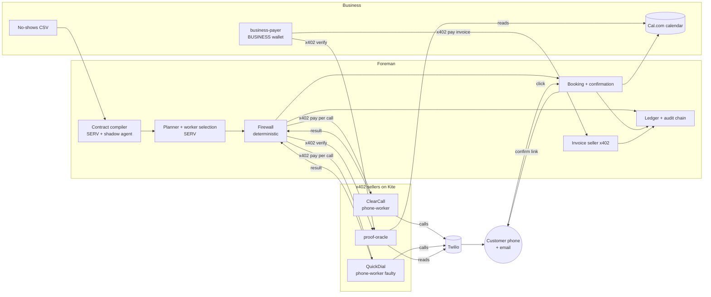
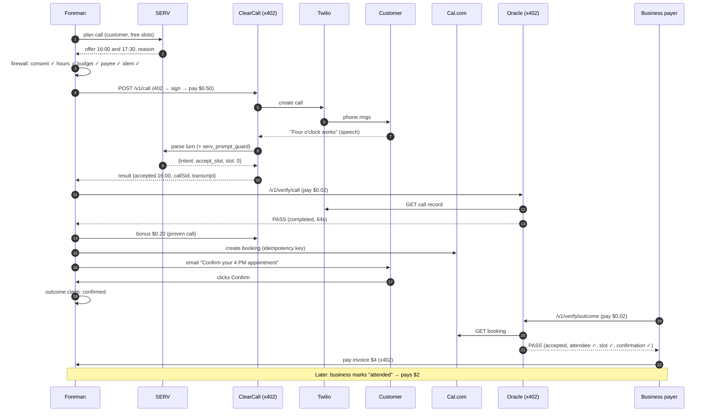
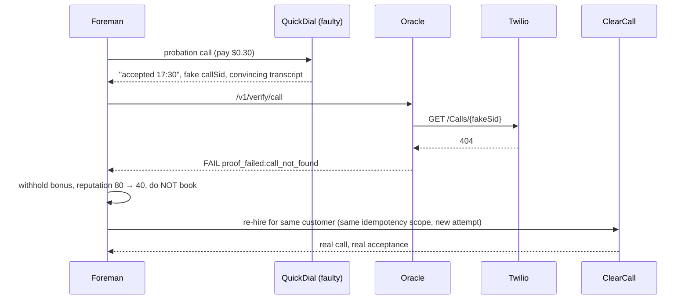

# 02 · Architecture

## Design principles

1. **Rent the physical world, don't fake it.** Real calls (Twilio), real calendar (Cal.com), real email, real on-chain payments (Kite testnet).
2. **The model decides, code authorises.** SERV makes judgment calls; a deterministic firewall and deterministic oracles gate every action and every payment.
3. **Every party is a separate agent with its own wallet.** Even though we run them all for the hackathon, they never share keys or databases.
4. **Everything is replayable.** Every event is written to a hash-chained log; the console can replay a recorded run with real tx hashes.

## Services

| Service | Port | Role | Wallet | Paid by | Pays |
|---|---|---|---|---|---|
| `foreman` | 4000 (+ paywalls 4001/4002) | Outcome agent: contracts, planning, hiring, booking, confirmation, ledger, SSE feed, invoice seller | `FOREMAN_PK` | business-payer | phone workers, oracle |
| `phone-worker` (ClearCall) | 4100 → 4110 | x402 seller: places a call, runs the voice loop, returns structured result | `CLEARCALL_PAYTO` (receive only) | foreman | — |
| `phone-worker` (QuickDial) | 4101 → 4111 | Same code, `WORKER_MODE=faulty` for the demo | `QUICKDIAL_PAYTO` | foreman | — |
| `proof-oracle` | 4200 → 4210 | x402 seller: `/v1/verify/call`, `/v1/verify/outcome` — deterministic checks | `ORACLE_PAYTO` | foreman, business-payer | — |
| `business-payer` | 4300 | The clinic's payment agent: watches claims, asks the oracle, pays Foreman's invoices | `BUSINESS_PK` | — | foreman, oracle |
| `console` | 5173 | React UI: live feed, ledger, workers, safety, business view, replay mode | — | — | — |

Ports written `A → B` mean: public x402 paywall on A (kite-x402-hono) in front of the service on B. Full port map in `07-kite-x402-payments.md`.

Shared code lives in `packages/shared`: Kite network constants, x402 buyer client, x402 seller helper, SERV client, types, idempotency, audit chain.

## Repository layout

```
foreman/
├─ apps/
│  └─ console/                 # Vite + React + Tailwind + shadcn/ui
├─ services/
│  ├─ foreman/                 # Hono, bun:sqlite
│  │  ├─ src/contract/         # SERV contract compiler + zod schema
│  │  ├─ src/planner/          # SERV call planner + worker selection
│  │  ├─ src/firewall/         # deterministic policy engine, typed refusals
│  │  ├─ src/booking/          # Cal.com client (slots, create, cancel)
│  │  ├─ src/confirm/          # confirmation tokens, email, /c/:token page
│  │  ├─ src/ledger/           # payments, margin, audit chain
│  │  ├─ src/hire/             # x402 buyer calls to workers + oracle
│  │  ├─ src/invoice/          # x402 seller: /v1/invoice/:outcomeId/:milestone
│  │  └─ src/feed/             # SSE event stream
│  ├─ phone-worker/            # Hono, Twilio voice loop, x402 seller
│  ├─ proof-oracle/            # Hono, Twilio + Cal.com readers, x402 seller
│  └─ business-payer/          # small loop: poll claims → verify → pay
├─ packages/
│  └─ shared/                  # kite.ts, x402-buyer.ts, x402-seller.ts, serv.ts, audit.ts, types.ts
├─ demo/
│  ├─ no-shows.csv             # demo customers (your and friends' verified numbers)
│  └─ recorded-run.json        # exported for replay mode
├─ docs/                       # this pack
└─ package.json                # bun workspaces, "dev:all" via concurrently
```

## Wallets (all on Kite testnet, chain 2368)

| Wallet | Holds | Signs | Needs |
|---|---|---|---|
| Business | test pieUSD | x402 payments to Foreman + oracle | pieUSD from faucet |
| Foreman | test pieUSD | x402 payments to workers + oracle | pieUSD from faucet |
| ClearCall, QuickDial, Oracle | receive only | nothing | just an address |

x402 "exact" payments use EIP-3009 `transferWithAuthorization` signatures, so **payers don't need KITE for gas** — the facilitator submits the transaction. Keep a little KITE anyway for any manual transfers.

## Component diagram



## Sequence: one customer, happy path



## Sequence: the lying worker



## Event flow and the live feed

Every state change emits an event: `{id, ts, jobId, type, actor, data, prevHash, hash}`. Foreman stores it in SQLite and pushes it over SSE (`GET /api/feed`). The console renders the feed; replay mode reads the same events from `recorded-run.json` on a timer. See `10-api-and-data-model.md` for the event types.

## Deployment (free)

| Piece | Where | Note |
|---|---|---|
| All Bun services | Your laptop + a **Cloudflare Tunnel** (`cloudflared tunnel --url`) or ngrok free | Twilio needs a public HTTPS webhook URL for the phone workers |
| Console (replay mode) | **Vercel** free (static build) | The public demo link for judges |
| Console (live mode) | Local, shown in the video | Needs your keys |

Optional: Render free web services for the Bun apps if you want a live public backend; cold starts make it unreliable for live calls, so record the video locally.
